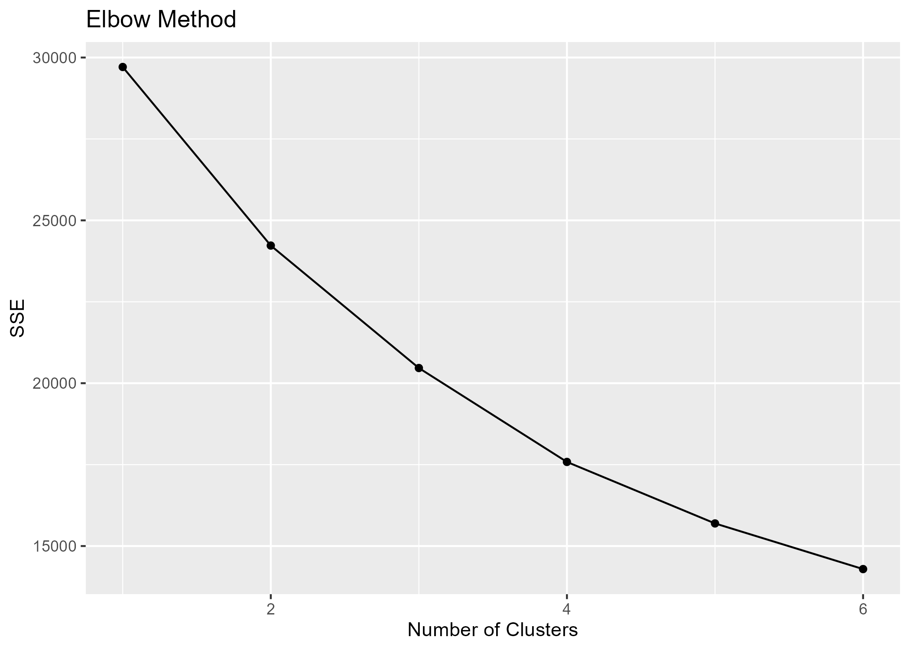
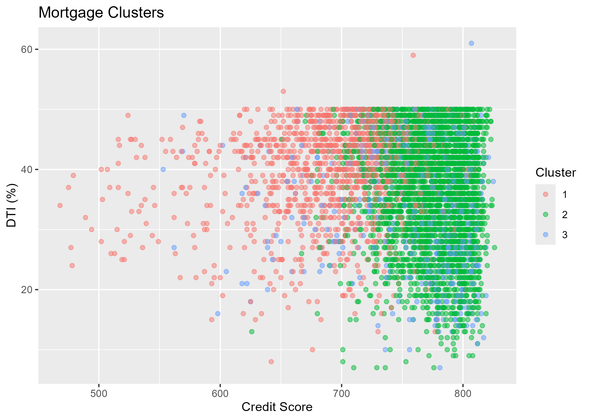
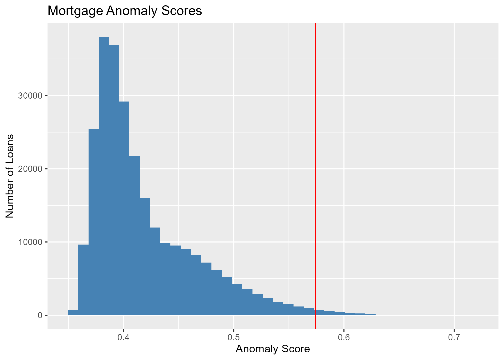
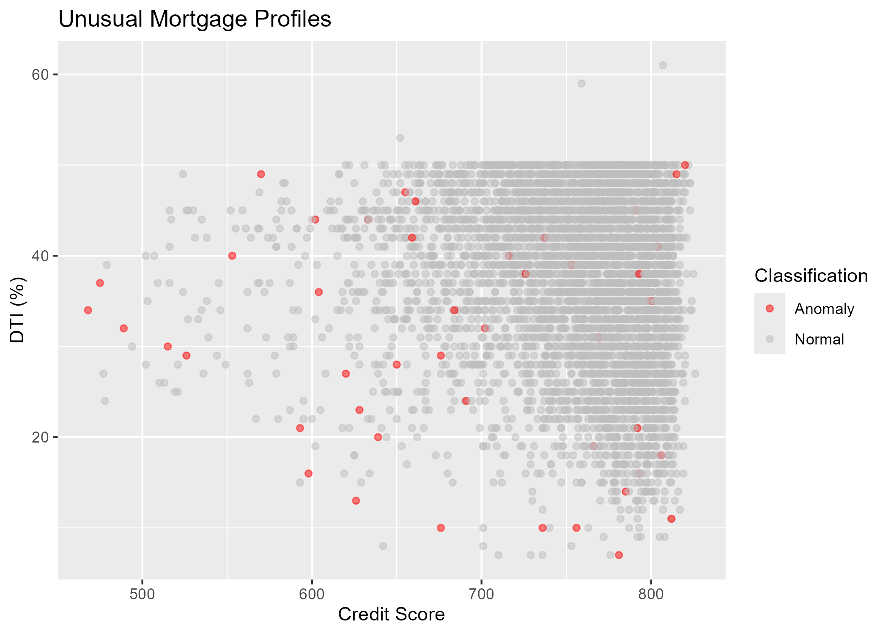
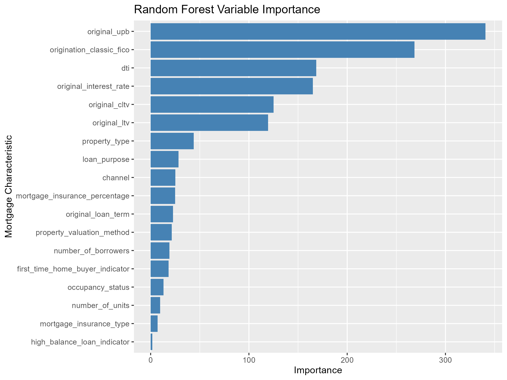
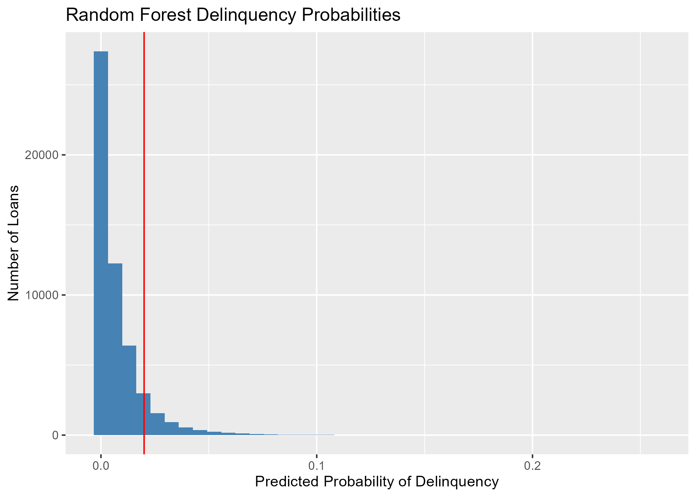

# Mining Results

Three data mining methods were applied to the Fannie Mae 2026 Q1 mortgage dataset: K-means clustering, Isolation Forest, and Random Forest.

## K-Means Clustering

K-means was used to group mortgages based on six variables: credit score, DTI, LTV, original loan balance, interest rate, and loan term. After removing missing values, 266,266 loans remained. The variables were standardized before clustering.

Three clusters were used for the initial analysis.

### Results

| Variable | Cluster 1 | Cluster 2 | Cluster 3 |
|---|---:|---:|---:|
| Loans | 68,981 | 166,854 | 30,431 |
| Average Credit Score | 691 | 774 | 762 |
| Average DTI | 39.95% | 36.18% | 33.24% |
| Average LTV | 71.68% | 76.61% | 59.11% |
| Average Loan Balance | $255,900 | $405,239 | $310,384 |
| Average Interest Rate | 6.55% | 6.00% | 5.64% |
| Average Loan Term (Months) | 356 | 359 | 194 |

- **Cluster 1:** Lower credit scores, higher DTI ratios, and higher interest rates.
- **Cluster 2:** Higher credit scores and larger loan balances.
- **Cluster 3:** Shorter loan terms and lower LTV ratios.

### Elbow Method

Sum of Squares Error decreases as K increases, but there is no clear elbow at K = 3.

### Mortgage Clusters

The plot shows credit score and DTI, although all six variables were used for clustering.

### Delinquency Comparison

| Cluster | Delinquency Rate |
|---|---:|
| 1 | 1.12% |
| 2 | 0.54% |
| 3 | 0.48% |

Cluster 1 had approximately twice the observed delinquency rate of the other two clusters.

## Anomaly Detection

Isolation Forest was used to identify unusual mortgages using the same six variables. The model used 100 trees, and the top 1% of anomaly scores were flagged.

Of the 266,266 loans, 2,663 were identified as anomalies.

### Anomaly Scores

The red line represents the 99th percentile of anomaly scores. Loans to the right of this line were classified as anomalies.

### Unusual Mortgage Profiles

The plot shows credit score and DTI for a sample of loans, although all six variables were used for anomaly detection.

### Results

| Variable | Anomaly | Normal |
|---|---:|---:|
| Average Credit Score | 692 | 752 |
| Average DTI | 30.31% | 36.89% |
| Average LTV | 47.48% | 73.60% |
| Average Loan Balance | $308,385 | $356,188 |
| Average Interest Rate | 5.92% | 6.11% |
| Average Loan Term (Months) | 205 | 341 |

Anomalous loans had lower credit scores, DTI ratios, LTV ratios, and shorter loan terms.

The delinquency rate was 0.94% for anomalous loans compared with 0.68% for normal loans.

This suggests that unusual mortgage profiles are not necessarily high-risk mortgages.

## Random Forest

Random Forest was used to predict mortgage delinquency. The data was split into 80% training and 20% testing, and the model used 100 trees.

A 2% probability cutoff was used because delinquency was rare.

### Results

| Metric | Result |
|---|---:|
| Accuracy | 89.37% |
| Precision | 1.22% |
| Recall | 17.14% |

The model correctly identified 66 delinquent loans but missed 319 and incorrectly flagged 5,340 non-delinquent loans.

The low precision and recall show that the model struggled to identify delinquency. Accuracy was misleading because most loans were not delinquent.

### Variable Importance

Original loan balance, credit score, DTI, and interest rate were the most important variables in the model for predicting delinquency.

### Predicted Delinquency Probabilities

Most loans received low predicted probabilities. The red line represents the 2% classification cutoff.

## Summary

K-means identified three mortgage groups, with Cluster 1 having the highest observed delinquency rate.

Isolation Forest identified unusual loan profiles, but these loans had only a slightly higher delinquency rate.

Random Forest struggled to predict delinquency because of the large class imbalance.

These are initial findings based on the available observation period. Sensitivity analysis will be used to test different model settings and evaluate the results further.
